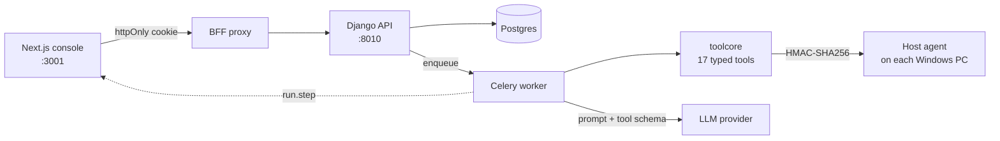

# DeskPilot

**An IT helpdesk agent that investigates real machines — and cannot change anything without a human saying so.**


DeskPilot reads a support ticket, investigates the affected Windows host with read-only diagnostics, and either explains the cause or proposes a fix. Every fix waits behind an approval bound to the exact arguments a human reviewed.

The interesting part is not that it uses an LLM. It is that the system is built so the LLM **cannot** do damage — and can prove it after the fact.

---

## Contents

- [Why this exists](#why-this-exists)
- [Architecture](#architecture)
- [The safety model](#the-safety-model)
- [Tool catalog](#tool-catalog)
- [Quick start](#quick-start)
- [Configuration](#configuration)
- [API reference](#api-reference)
- [Operator console](#operator-console)
- [Evaluation](#evaluation)
- [Testing](#testing)
- [Repository layout](#repository-layout)
- [Known limitations](#known-limitations)

---

## Why this exists

Level-1 IT support is mostly the same ten checks, done thousands of times: is the disk full, is the spooler running, is the account locked, what does the event log say. It is slow, repetitive, and easy to do badly at 2 a.m.

An LLM is genuinely good at deciding *which* of those checks to run. It is genuinely bad at being trusted with the result. So the design separates the two:

| The model decides | The platform decides |
|---|---|
| which tool to call next | whether that tool exists |
| what arguments to pass | whether the arguments are valid |
| when it has enough evidence | whether the caller's role allows it |
| what the diagnosis is | whether the target is in scope |
| | whether a human approved it |
| | what gets written to the audit log |

The model never gets a shell, never gets a generic "run this" primitive, and never sees a credential.

---

## Architecture



Three deployable pieces:

1. **`backend/`** — Django + DRF API, Celery worker, agent loop, guardrail persistence.
2. **`packages/toolcore/`** — the tool layer. **No Django imports.** This is deliberate: the same registry serves the Celery worker *and* the standalone MCP server, so the tool semantics cannot drift between them.
3. **`services/hostagent/`** — a small FastAPI process on `127.0.0.1:8765` on each managed Windows PC. It exposes eight *named* read capabilities and authenticates every call with HMAC over `timestamp.body`. It has no write capability at all.

The console lives beside this directory in [`../web`](../web) and is also published as its own repository.

---

## The safety model

This is the part worth reading.

### One chokepoint

Every invocation — agent, MCP client, human via the API — passes through `toolcore.execute_tool`. Checks run in this order, and the first failure denies:

| # | Check | Refuses |
|---|---|---|
| 1 | Kill switch — `halted` | anything, before a single lookup happens |
| 2 | Registry lookup | tools that do not exist |
| 3 | Policy | tools disabled by an administrator |
| 4 | Kill switch — `paused` | **writes only**; reads keep working, so diagnostics stay available |
| 5 | Role authorisation | callers below the tool's `allowed_roles` |
| 6 | Schema validation | wrong types, unknown fields, out-of-range values |
| 7 | Tool guard | requests no approval could ever authorise (privileged groups) |
| 8 | Approval gate | writes without a matching, unspent approval |
| 9 | Execution + verification | a write that cannot be verified is reported as a failure |
| 10 | Audit | — always runs, in a `finally`, including for every refusal above |

Policy may raise a tool's risk class but never lower it: a row claiming `READ` cannot turn a declared write into an unapproved read.

### Two controls that are modelled but not enforced

Stated here rather than left for a reviewer to discover:

- **Target scoping.** Tools accept a target argument (`sam`, `root`, `host`) and nothing ties it to the ticket's own requester or device. A `TECHNICIAN`-role agent can therefore propose an unlock for *any* account — bounded by role and human approval, but not by the ticket. The plan called for binding the target to the ticket; the schema and the guard exist, the binding does not.
- **`max_calls_per_run`.** The field exists on `ToolPolicy` and is exposed by the API, but nothing reads it. The loop's own `AgentLimits` (iterations, tool calls, duration, cost) is what actually bounds a run.

### Deliberate choices

**There is no `run_command`.** Not a filtered one, not an allowlisted one. Remediation arrives as named tools with typed arguments. When someone asks "what stops `rm -rf /`?", the answer is *"there is no interface that accepts a command"* — which is a stronger answer than a regex.

**Approvals are bound to arguments, not to tools.** The approval token *is* `args_hash(validated_args)`, and the comparison happens inside the chokepoint, not in the caller. Approving "clear `user_temp`" cannot execute "clear `windows_temp`", and a buggy host cannot skip the check. Approvals are single-use and expire in 30 minutes.

**The person who reported it does not sign it off.** `Ticket.requester` is a real foreign key, and a `WRITE_DESTRUCTIVE` approval from that account is refused. Reversible changes are exempt — demanding a second technician to restart the print spooler only teaches people to click approve without reading.

**Privileged groups are a hard deny, not a policy setting.** `add_group_member` on `Domain Admins` is refused before an approval is even created, because no approval should be able to authorise it. Asking a human to approve the impossible just wastes their attention and leaves a misleading audit trail.

**Fail closed.** If the kill switch or the policy lookup raises, the call is denied. A guardrail that degrades to "no policy" is not a guardrail.

**The audit is unconditional.** Denials and approval requests are recorded, not just successes. The refusals *are* the safety evidence — the console puts "blocked actions" on the dashboard for exactly that reason.

**A requester sees only their own tickets.** Visibility is enforced in the queryset, not in the UI: list, detail, run and trace endpoints all share one rule, so a requester cannot read another person's ticket — or its tool output — by guessing an id. The same rule now carries an organisation filter, for the same reason: an id from another account resolves to a 404, not to someone else's data.

**The role belongs to the membership, not the person.** `CustomUser.role` is a fallback for a deployment that never turned tenancy on; the authoritative value is `Membership.role`, which is why the same human can be an `ADMIN` of their own account and a `REQUESTER` in a customer's. Resolution happens in the authentication step rather than in middleware, because DRF authenticates *inside* the view — a middleware looking at `request.user` would see an anonymous user on every JWT request.

**An account cannot be left without an administrator.** The last active `ADMIN` cannot be demoted or deactivated, and the owner cannot be deactivated at all. A platform superuser can still step in — see below — but that is an incident path, not a workflow, so the ordinary mistake is made impossible rather than merely recoverable.

**There are two levels of administrator, and they are not the same thing.** A *company admin* is an `ADMIN` **of one organisation**: they can add its departments, add its people and set their passwords, and they cannot see or touch any other account. A *project admin* is a Django `is_superuser` — the operator of DeskPilot itself, who is deliberately **not** a member of any customer's account. They may name an account with `X-Organization` and act in it as an administrator; that is the only escape hatch when a client locks themselves out, it requires naming the tenant explicitly (there is no default), and `request.membership` stays `None` so nothing can mistake them for a real member. Every org-scoped queryset still applies, so the hatch opens one named account, not all of them.

**Passwords, not invitation links.** An administrator adding a member sets a password, or lets the server generate one, and it is returned exactly once. The person signs in immediately with email and password. There is no mail transport in this project, so a link-based invitation would mean someone who cannot get in until they redeem a URL they were sent out-of-band — and no way back at all if they forget. `POST org/members/{id}/password/` is the recovery path, available to both levels of administrator.

**The model never sees a credential.** `reset_password` returns a real password, so it goes through a `password_sink` into a vault and the model only ever receives a reference. A host that forgets to supply a sink fails closed.

### Writes are simulated by default

`build_remediation_adapter()` returns a `SimulatedHost` unless **both** `SAFE_MODE=0` and `ALLOW_REAL_WRITES=1` are set. A default checkout of this repository physically cannot delete a file or restart a service on the machine hosting it.

`LocalRemediation` is the real implementation, and its temp roots are injectable — so real deletion is tested against a temporary directory rather than asserted to work.

---

## Tool catalog

17 tools across three domains. Risk classes: `READ` (never needs approval), `WRITE_REVERSIBLE`, `WRITE_DESTRUCTIVE`.

| Tool | Risk | Domain | What it does |
|---|---|---|---|
| `get_system_health` | READ | host | CPU, memory, uptime, boot time, pending reboot |
| `get_disk_health` | READ | host | per-volume capacity, free %, low-space flag |
| `list_services` | READ | host | Windows services by name and state |
| `read_event_log` | READ | host | Event Log entries by severity and window |
| `get_installed_software` | READ | host | installed products, version, publisher |
| `get_windows_update_status` | READ | host | pending update count, recent hotfixes |
| `list_listening_ports` | READ | network | listening sockets with owning process |
| `test_connectivity` | READ | network | DNS result, resolved IPs, TCP latency |
| `restart_service` | WRITE_REVERSIBLE | remediation | restarts a service, verifies it came back |
| `clear_temp_files` | WRITE_DESTRUCTIVE | remediation | deletes files under a temp root, size-bounded |
| `flush_dns_cache` | WRITE_REVERSIBLE | remediation | flushes the resolver cache |
| `lookup_user` | READ | identity | account state, lockout, groups, devices |
| `get_group_membership` | READ | identity | members of a group, or groups of a user |
| `unlock_account` | WRITE_REVERSIBLE | identity | clears a lockout |
| `reset_password` | WRITE_DESTRUCTIVE | identity | sets a generated password, forces change |
| `add_group_member` | WRITE_REVERSIBLE | identity | adds a user to a non-privileged group |
| `remove_group_member` | WRITE_DESTRUCTIVE | identity | removes a user from a group |

`flush_dns_cache` is the only write that needs no approval: gating a harmless no-op would train approvers to click through.

---

## Quick start

Everything below is run **from `backend/`**.

### With Docker

```bash
cp .env.example .env          # then set LLM_API_KEY
docker compose up -d --build  # db + redis + api + worker
docker compose exec api python manage.py seed_tool_policies
docker compose exec api python manage.py bootstrap_demo
```

API on `http://localhost:8010`, Swagger at `/api/v1/docs/`.

### Local (Windows, no Docker)

```bash
python -m venv .venv
.venv/Scripts/pip install -r requirements/dev.txt
.venv/Scripts/pip install -e packages/toolcore

.venv/Scripts/python manage.py migrate
.venv/Scripts/python manage.py seed_tool_policies
.venv/Scripts/python manage.py bootstrap_demo
.venv/Scripts/daphne.exe -b 127.0.0.1 -p 8010 config.asgi:application
```

Daphne rather than `runserver`, because the live trace needs WebSockets.

Verify the model before trusting any number it produces:

```bash
.venv/Scripts/python manage.py check_llm
```

Demo users are created by `bootstrap_demo`; `admin@deskpilot.test` / `DeskPilot!2026` is the administrator.

### Common commands

`make` is **not** bundled with Git for Windows. The raw commands always work; the
Makefile is a convenience for Linux, macOS and CI.

| Task | Raw command | With `make` |
|---|---|---|
| API on :8010 | `.venv/Scripts/python -m daphne -b 127.0.0.1 -p 8010 config.asgi:application` | `make api` |
| Console on :3001 | `cd ../web && npm run dev` | `make web` |
| Tests | `.venv/Scripts/python -m pytest` | `make test-local` |
| Verify the model | `.venv/Scripts/python manage.py check_llm` | `make check-llm` |
| Eval self-check | `.venv/Scripts/python manage.py run_evals --mode oracle` | `make eval` |
| Regenerate results | `.venv/Scripts/python manage.py eval_report` | `make report` |
| Demo data | `.venv/Scripts/python manage.py bootstrap_demo` | `make demo` |

To get `make` on Windows: `winget install ezwinports.make` (or use WSL).

---

## Configuration

| Variable | Default | Purpose |
|---|---|---|
| `LLM_BASE_URL` | — | Any OpenAI-compatible endpoint |
| `LLM_MODEL` | — | Model name at that provider |
| `LLM_API_KEY` | — | Required; runs fail loudly without it |
| `LLM_MAX_COST_PER_RUN_USD` | unset | Hard budget per run |
| `DATABASE_URL` | SQLite | Postgres in Docker |
| `REDIS_URL` | in-process cache | Required for the Celery worker |
| `DIRECTORY_BACKEND` | `fake` | `fake` (seeded tenant) or `ldap` |
| `LDAP_URI` / `LDAP_BASE_DN` / `LDAP_BIND_*` | — | Used when `DIRECTORY_BACKEND=ldap` |
| `SAFE_MODE` | `1` | Writes go to a simulated host |
| `ALLOW_REAL_WRITES` | `0` | Must be `1` *and* `SAFE_MODE=0` for real writes |
| `HOSTAGENT_URL` / `HOSTAGENT_TOKEN` | — | The per-PC probe endpoint |

---

## API reference

All routes are under `/api/v1/`. Interactive docs at `/api/v1/docs/`.

| Method | Path | Auth | Purpose |
|---|---|---|---|
| `POST` | `auth/login/` | public | Credentials in, tokens + user out |
| `GET` | `auth/me/` | any | Session: user and workspace role |
| `GET` | `stats/` | any | Dashboard KPIs |
| `GET`/`POST` | `tickets/` | any | Queue and creation (paginated) |
| `GET` | `tickets/{id}/` | any | Ticket, messages, latest run id |
| `POST` | `tickets/{id}/run/` | service desk+ | Queue an agent run (idempotent via `client_request_id`) |
| `GET` | `runs/` | any | Active runs, for the sidebar |
| `GET` | `runs/{id}/` | any | Run with its full step trace |
| `POST` | `runs/{id}/ws-ticket/` | any | 60-second, single-run token for the trace socket |
| `GET` | `tools/` | any | The catalog as the agent sees it |
| `POST` | `tools/{name}/invoke/` | service desk+ | Invoke one tool through the chokepoint |
| `GET`/`PATCH` | `guardrails/policies/` | admin | Per-tool enable/risk/approval/roles |
| `GET`/`POST` | `guardrails/killswitch/` | admin | `open` / `paused` / `halted` |
| `GET` | `guardrails/invocations/` | service desk+ | The audit trail, denials included (paginated) |
| `GET` | `guardrails/approvals/` | service desk+ | Pending approvals (paginated) |
| `POST` | `guardrails/approvals/{id}/{approve\|reject}/` | technician+ | Decide one request |
| `GET` | `evals/runs/` | any | Eval history with metrics |
| `GET` | `directory/employees/`, `devices/` | any | The account tenant |
| `GET` | `org/` | any member | The organisation you are acting in, and what you may do in it |
| `GET`/`POST` | `org/departments/` | admin (write) | Operator departments: list, add |
| `PATCH`/`DELETE` | `org/departments/{id}/` | admin | Rename, re-parent, archive, or delete (with `?reassign_to=`) |
| `GET` | `org/members/` | service desk+ | The roster, filterable by `q`, `role`, `department_id` |
| `POST` | `org/members/` | admin | Add a person with a password (given or generated), returned once |
| `PATCH` | `org/members/{id}/` | admin | Change role, department, or active state |
| `DELETE` | `org/members/{id}/` | admin | Deactivate (never delete — the history points at this user) |
| `POST` | `org/members/{id}/password/` | admin | Set or reset one password; the account's only recovery path |
| `POST` | `org/invites/accept/` | public | Optional: redeem an invitation token issued through the API |

WebSocket: `ws://…/ws/runs/{id}/?token=…` where the token comes from `ws-ticket/`. It is not the session token — that lives in an httpOnly cookie and is deliberately never exposed to JavaScript.

---

## Operator console

A Next.js console with nine screens: Overview, Tickets, Ticket detail with a live agent trace, Approvals, Tools, Audit log, Evaluations, Directory, Settings.

It never holds a token in JavaScript: the browser calls a BFF route, which attaches the httpOnly session cookie and forwards to Django. See [`../web/README.md`](../web/README.md).

```bash
cd web && npm install && npm run dev   # http://localhost:3001
```

---

## Evaluation

A **120-case golden set** (`evals/dataset/cases.jsonl`) of realistic office scenarios: taxonomy variations, adversarial prompt injections, and edge cases, each with an expected triage, category, priority and the tools that should — and should not — be called.

Three modes:

| Mode | What it measures |
|---|---|
| `oracle` | the **harness** — scripted decisions from the dataset's own expectations |
| `replay` | recorded model decisions, free and deterministic in CI |
| `live` | the actual model, against the real provider |

`make eval-control` runs a deliberately lazy agent that never calls a tool and escalates everything. It scores **7.5%** triage accuracy against the oracle's 100% and fails the gates. That control is what proves the metrics discriminate: a harness that only ever reports 100% has demonstrated nothing.

**What this repository does not claim:** there is no measured model accuracy figure yet. `evals/cassettes/` is empty and no `live` run has been recorded, so `docs/RESULTS.md` reports the harness self-check and says so in a generated banner. Every number that ends up there is reproducible with `make report` from a committed dataset — which is the constraint that keeps the claims honest.

---

## Testing

```bash
.venv/Scripts/python -m pytest
# 282 passed, 19 skipped (LDAP contract tests skip without a container)
# 301 passed with OpenLDAP running
```

| Suite | Covers |
|---|---|
| `test_toolcore_unit.py` | risk ordering, redaction, hashing, schema rejection, registry |
| `test_audit_trail.py` | exactly one row per attempt, including denials; secrets never persisted |
| `test_guardrails.py` | approval gate, policy escalation, role auth, kill switch |
| `test_approvals.py` | nothing runs before approval, then exactly once; expiry, replay, TOCTOU, self-approval |
| `test_remediation.py` | simulation by default; real deletion tested on a temp dir |
| `test_agent_runtime.py` | finish, ask, budgets, duplicate actions, provider refusal |
| `test_agent_trace.py` | socket auth, run-scoped tickets, step delivery |
| `test_agent_api.py` | ticket CRUD, idempotent triggering, **requester visibility** |
| `test_directory.py` + `test_ldap_contract.py` | **the same contract** against the fake tenant and real OpenLDAP |
| `test_organizations.py` | departments, invitations, cross-tenant 404s, role-per-account, last-admin lockout |
| `test_mcp_parity.py` | MCP schema and result parity with the internal registry |
| `test_evals.py` | metric maths, gate logic, negative control |

`tests/conftest.py` makes the suite genuinely offline: an autouse fixture patches `socket.connect` and refuses any non-loopback address. Localhost stays open for the LDAP contract tests.

---

## Repository layout

```
DeskPilot/
├── backend/                  ← this repository
│   ├── apps/                 Django API, agent loop, guardrails, tests
│   │   ├── agent/            bounded ReAct loop, runs, steps, trace socket
│   │   ├── guardrails/       the chokepoint's Django side: policy, audit, approvals
│   │   ├── helpdesk/         tickets and messages
│   │   ├── organizations/    organisations, memberships (role per account), departments
│   │   ├── directory/        fake tenant + LDAP behind one interface
│   │   ├── llm/              provider-agnostic client, cost accounting, prompts
│   │   └── evals/            golden-set runner, metrics, reporting
│   ├── packages/toolcore/    framework-free tool registry — no Django imports
│   ├── services/mcp_server/  MCP server: same registry, second consumer
│   ├── services/hostagent/   per-PC probe: HMAC-signed, read-only, no writes
│   ├── evals/                120-case dataset and cassettes
│   ├── docs/                 architecture notes, integration plan, RESULTS.md
│   ├── tests/                pytest suite
│   ├── docker-compose.yml    db + redis + api + worker
│   └── Makefile
└── web/                      Next.js console (separate repository)
```

Everything the backend needs is inside `backend/`, so the compose file, the
Makefile and the virtualenv all sit here and every command in this README is run
from this directory.

---

## Known limitations

Stated plainly, because a README that hides these is not worth reading:

1. **The LLM provider needs a daily check-in.** On the free tier used for development, runs fail with `402 Payment Required` until the provider's daily check-in is done. The trace says so explicitly rather than blaming the agent's budget.
2. **No measured accuracy yet.** The harness, the metrics and the negative control are verified; the model has not been run against the 120 cases. No accuracy number is claimed anywhere in this repository.
3. **Per-ticket host routing is not wired.** `HostAgentDiagnostics` implements the same protocol as `LocalDiagnostics` and is tested, but `default_adapters()` still returns `LocalDiagnostics` — so the agent inspects the machine the *worker* runs on. Routing a ticket to its own PC needs an asset inventory (hostname → agent URL) that does not exist yet.
4. **Writes are simulated by default**, as described above.
5. **`run.iterations` stays `0` on a failed run.** The exception escapes the loop before its bookkeeping. The persisted step count is the honest measure of how many attempts happened.
6. **Multi-tenant, but not self-service.** The schema supports many organisations —
   `Organization`, `Membership` (role *per account*) and `Department` — and tickets,
   audit rows, approvals and the dashboard are all tenant-scoped. What is missing is
   everything around it: no signup, no way for a person to join an account without an
   administrator adding them, and no mail transport (passwords are handed over
   directly rather than emailed). `directory.Employee` is still global: those are the
   accounts the customer *supports*, not the people who work the desk, and they are
   not tenant-scoped.
7. **Tool targets are not scoped to the ticket.** See [the note above](#two-controls-that-are-modelled-but-not-enforced). Role and approval still apply; ticket-scoping does not.
8. **`max_calls_per_run` is inert.** It is modelled and serialised but never read; `AgentLimits` is the real bound.

---

## License

No license file is included. Treat this as source-available for review; contact the author before reuse.
